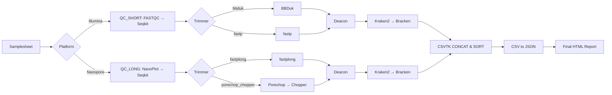

# nf-qcflow

A comprehensive [Nextflow](https://www.nextflow.io/) bioinformatics pipeline for next-generation sequencing (NGS) data quality processing. nf-qcflow performs quality control, host sequence removal, contamination screening, and generates detailed statistical reports in both tabular and HTML formats. The pipeline supports both **Illumina short-read** and **Oxford Nanopore long-read** sequencing platforms.

A demo of the nf-qcflow output is available on the [nf-qcflow output demo page](https://github.com/xiaoli-dong/nf-qcflow/tree/main/docs/demo).

---

## Pipeline Summary

nf-qcflow supports both short and long reads:



### Short Reads Quality Check and Quality Control

- Quality checks: [FastQC](https://www.bioinformatics.babraham.ac.uk/projects/fastqc/)
- Quality control: [BBDuk](https://jgi.doe.gov/data-and-tools/software-tools/bbtools/bb-tools-user-guide/bbduk-guide/) | [fastp](https://github.com/OpenGene/fastp)
- Host removal (dehost): [Deacon](https://github.com/dcdanko/deacon)
- Taxonomic assignment and contamination check: [Kraken2](https://ccb.jhu.edu/software/kraken2/) & [Bracken](https://ccb.jhu.edu/software/bracken/)
- Read statistics: [seqkit stats](https://bioinf.shenwei.me/seqkit/usage/#stats)
- Tabular and HTML reports

### Long Reads Quality Check and Quality Control

- Quality checks: [NanoPlot](https://github.com/wdecoster/NanoPlot)
- Adapter trimming, quality and length filtering (choose one):
  - **Porechop + Chopper**
    - Adapter removal: [Porechop](https://github.com/rrwick/Porechop)
    - Quality and length filtering: [Chopper](https://github.com/wdecoster/chopper)
  - **fastplong**: ultrafast preprocessing and quality control ([fastplong](https://github.com/OpenGene/fastplong))
- Host removal (dehost): [Deacon](https://github.com/dcdanko/deacon)
- Taxonomic assignment and contamination check: [Kraken2](https://ccb.jhu.edu/software/kraken2/) & [Bracken](https://ccb.jhu.edu/software/bracken/)
- Read statistics: [seqkit stats](https://bioinf.shenwei.me/seqkit/usage/#stats)
- Tabular and HTML reports

---

## Quick Start

> [!NOTE]
> If you are new to Nextflow and nf-core, please refer to [this page](https://nf-co.re/docs/usage/installation) on how to set up Nextflow. Make sure to [test your setup](https://nf-co.re/docs/usage/introduction#how-to-run-a-pipeline) with `-profile test` before running the workflow on actual data. This project was built with nf-core/tools 4.0, which requires Nextflow 25.10.4 or later.

### 1. Clone the repository

```bash
git clone https://github.com/xiaoli-dong/nf-qcflow.git
```

### 2. Check workflow options

```bash
nextflow run path_to/nf-qcflow --help
```

### 3. Prepare the samplesheet

nf-qcflow requires a CSV samplesheet containing sequence information for each sample:

**samplesheet.csv**

```csv
sample,fastq_1,fastq_2,fastq_long
sample_paired_short_long,shortreads_1.fastq.gz,shortreads_2.fastq.gz,longreads.fastq.gz
sample_single_short_long,shortreads.fastq,NA,longreads.fastq.gz
sample_only_long,NA,NA,longreads.fastq.gz
```

**Samplesheet format requirements:**

- The first row is the header describing the columns.
- Each row is a unique sample; the first column (`sample`) is the unique sample ID.
- When information for a column is missing, fill it with `NA`.
- `fastq_1` and `fastq_2` are reserved for short-read files.
- `fastq_long` is reserved for the long-read file.

### 4. Run the pipeline

```bash
# Run locally
nextflow run path_to/nf-qcflow \
  -profile singularity \
  --input samplesheet.csv \
  --outdir results \
  -resume

# Run on an HPC cluster with Slurm
nextflow run path_to/nf-qcflow \
  -profile singularity,slurm \
  --input samplesheet.csv \
  --outdir results \
  -resume
```

> [!IMPORTANT]
> Please provide pipeline parameters via the CLI or the Nextflow `-params-file` option. Custom config files, including those provided by the `-c` Nextflow option, can be used to provide any configuration **except for parameters**. See the [documentation](https://nf-co.re/docs/usage/getting_started/configuration#custom-configuration-files) for more details.

---

## Command-Line Options

### Input/Output Options

| Parameter  | Type   | Description                                                                          |
|------------|--------|--------------------------------------------------------------------------------------|
| `--input`  | string | Path to the CSV file containing information about the samples                        |
| `--outdir` | string | Output directory where results will be saved (use absolute paths for cloud storage)  |

### General Parameters

| Parameter              | Type    | Default       | Description                                           |
|------------------------|---------|---------------|-------------------------------------------------------|
| `--skip_trimmer_short` | boolean | `false`       | Skip the trimmer for short reads                      |
| `--skip_trimmer_long`  | boolean | `false`       | Skip the trimmer for long reads                       |
| `--short_trimmer`      | string  | `fastp`       | Short read QC tool (`fastp` or `bbduk`)               |
| `--long_trimmer`       | string  | `fastplong`   | Long read QC tool (`fastplong` or `porechop_chopper`) |
| `--adapter_fasta`      | string  | `null`        | User-supplied adapter file                            |
| `--skip_dehost`        | boolean | `false`       | Skip the dehost process                               |

### Database Parameters

| Parameter        | Type   | Default                      | Description                          |
|------------------|--------|------------------------------|--------------------------------------|
| `--kraken2_db`   | string | `/your_path_to/kraken2_db`   | Path to Kraken2 database             |
| `--deacon_refdb` | string | `/your_path_to/deacon_db`    | Path to Deacon reference database    |

### Help Options

| Parameter       | Description                                                                         |
|-----------------|-------------------------------------------------------------------------------------|
| `--help`        | Show help for all top-level parameters (can specify a parameter for detailed help)  |
| `--help_full`   | Show help for all non-hidden parameters                                             |
| `--show_hidden` | Show hidden parameters (use with `--help` or `--help_full`)                         |

---

## Database Requirements

nf-qcflow requires several databases to be downloaded and configured. Provide their paths using the `--kraken2_db` and `--deacon_refdb` parameters.

### Kraken2 Database

Pre-built databases are available at <https://benlangmead.github.io/aws-indexes/k2>.

```bash
wget https://genome-idx.s3.amazonaws.com/kraken/k2_standard_16gb_20250402.tar.gz
tar -xvzf k2_standard_16gb_20250402.tar.gz
```

### Deacon Database

See the [Deacon repository](https://github.com/dcdanko/deacon) for instructions on downloading a reference database.

---

## Citations

If you use nf-qcflow in your research, please cite the appropriate tools:

- **FastQC**: Andrews, S. (2010). FastQC: A Quality Control Tool for High Throughput Sequence Data.
- **BBDuk / BBTools**: Bushnell, B. (2014). BBMap: A Fast, Accurate, Splice-Aware Aligner. Lawrence Berkeley National Laboratory, Report LBNL-7065E. <https://sourceforge.net/projects/bbmap/>
- **fastp**: Chen, S., Zhou, Y., Chen, Y., & Gu, J. (2018). fastp: an ultra-fast all-in-one FASTQ preprocessor. *Bioinformatics*, 34(17), i884-i890.
- **fastplong**: Chen, S. fastplong: ultrafast preprocessing and quality control for long reads. <https://github.com/OpenGene/fastplong>
- **Porechop**: Wick, R. R. (2017). Porechop: adapter trimmer for Oxford Nanopore reads. <https://github.com/rrwick/Porechop>
- **NanoPlot**: De Coster, W., D'Hert, S., Schultz, D. T., Cruts, M., & Van Broeckhoven, C. (2018). NanoPack: visualizing and processing long-read sequencing data. *Bioinformatics*, 34(15), 2666-2669.
- **Chopper**: De Coster, W., & Rademakers, R. (2023). NanoPack2: population-scale evaluation of long-read sequencing data. *Bioinformatics*, 39(5), btad311.
- **Deacon**: Constantinides, B., Lees, J., & Crook, D. W. (2025). Deacon: fast sequence filtering and contaminant depletion. *bioRxiv*, 2025.06.09.658732. <https://doi.org/10.1101/2025.06.09.658732>
- **hostile**: Bede, P. (2023). hostile: accurate decontamination of microbial sequences. *Journal of Open Source Software*.
- **Kraken2**: Wood, D. E., Lu, J., & Langmead, B. (2019). Improved metagenomic analysis with Kraken 2. *Genome Biology*, 20(1), 257.
- **Bracken**: Lu, J., Breitwieser, F. P., Thielen, P., & Salzberg, S. L. (2017). Bracken: estimating species abundance in metagenomics data. *PeerJ Computer Science*, 3, e104.
- **seqkit**: Shen, W., Le, S., Li, Y., & Hu, F. (2016). SeqKit: A Cross-Platform and Ultrafast Toolkit for FASTA/Q File Manipulation. *PLOS ONE*, 11(10), e0163962.

---

## Support

For issues, questions, or feature requests, please [open an issue](https://github.com/xiaoli-dong/nf-qcflow/issues) on GitHub.

## License

This project is licensed under the MIT License. See the [LICENSE](LICENSE) file for details.
